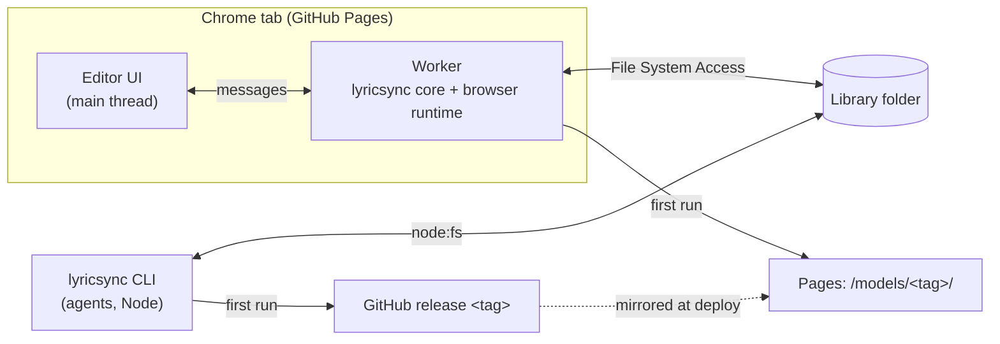

# lyricsync Editor: specification (draft)

Status: proposal. Nothing here is built yet. Section 11 lists what must be proven before the editor is built on top of it.

## 1. Goal

A standalone web app, hosted on GitHub Pages, that takes a song from inputs to a checked, syllable-timed lyrics file:

1. Pick a **library folder** on disk. Everything is stored there: models, songs, results.
2. Put a song's inputs in a folder in the library: **full audio** (the mix), **vocal extract** (an isolated vocal stem) and **lyrics**.
3. **Prepare** in the browser: beats from the mix, then audio evidence and the boundary model from the vocal.
4. **Solve**, then **review and correct** in a timeline editor. A correction marks a time as calibrated, and the solver re-decodes everything around it.
5. Two results, kept apart (section 3a): `lyrics.calibrated.json`, which is human-owned (what a person or agent confirmed), and `out/lyrics.json`, which is entirely generated (the solver's output, overwritten on every solve).

Agents work on the same library with the `lyricsync` CLI. The editor picks up their changes, and they pick up the editor's.

## Non-goals

- Browsers other than Chrome and Edge (desktop). The File System Access API and WebGPU decide this.
- Uploads, accounts or a server. Nothing leaves the machine except the model downloads.
- Video rendering, or project files of the video editor in this repository.
- Editing the lyrics text in the editor. The text comes from `lyrics.txt`; changing it means editing that file and preparing again, as with the CLI.

## 2. Architecture



- **One core, several hosts.** The solver and evidence code in `src/` gets no direct `node:` or `onnxruntime-node` imports. Everything platform-specific goes behind a `Runtime` interface (section 5). There are two implementations to start with: Node (CLI, tests, scripts) and browser (worker). A Tauri host is a third implementation of the same interface, not a rewrite (section 12).
- **The library folder is the only shared state.** Both sides read and write the same workspace files, with the same formats and the same evidence version. Evidence computed by one can be solved and edited by the other.
- **The worker does all heavy work:** model loading, prepare and solve. The UI thread only draws and handles input. A `FileSystemDirectoryHandle` can be posted to a worker.

## 3. Library folder

```
<library>/
  .lyricsync/
    library.json            {"version": 1}: marks the library root
    models/<tag>/…          downloaded model files (section 4), shared by the editor and the CLI
  <song>/                   any folder that contains a lyricsync.json (searched 2 levels deep)
    mix.wav                 full audio      (any name and any format Chrome decodes; chosen at setup)
    vocal.wav               vocal extract
    lyrics.txt              same format as the CLI (see README)
    lyricsync.json          workspace manifest (paths relative to the workspace)
    lyrics.calibrated.json  human-owned calibration (section 3a; the dev build keeps it in user_input/)
    anchors.json            the CLI's pins (section 3a)
    lyrics.def.json, beats.json, evidence/, sliced/, out/   (out/lyrics.json is generated only)
```

- **A song folder is a workspace.** Its input paths must resolve inside the library: the browser can only reach what is under the folder the user picked. The repository's `projects/<id>/lyricsync` layout (inputs in `../generated`) works when `projects/` is the library.
- **The CLI finds models through the library.** It walks up from the workspace to the nearest `.lyricsync/library.json`. Outside a library it stops with an error that says to run `lyricsync library init <dir>`.
- **New song (editor):** "New Song" creates the folder. Inputs are either already in it (copied there with the OS) or added with "Copy Files In", a local copy through a file picker, not an upload. The setup form then asks for:
  - the full audio and the vocal (dropdowns of the audio files in the folder);
  - the lyrics file;
  - the language;
  - the BPM (required: it is a tight prior);
  - an optional first downbeat.
- **Permission:** the directory handle is kept in IndexedDB, so a returning user reopens the library with one permission click. Chrome's "Allow on every visit" removes even that click.

## 3a. Calibration: the human file and the generated file

The calibrated file is the important artefact: it is the only place human (or agent) work is stored. Generated output never overwrites it, and it never feeds back into the generated output except as pins.

**`<song>/lyrics.calibrated.json` (human-owned):**
- Shape: the one the video project's editor already uses, so it can be copied into a project's `user_input/` as is.
  - Lines: `{i, text, start, end, calibrated, words[]}`.
  - Words: `{w, start, end, calibrated, syl: [s, e][], sylText[], sylCalibrated: boolean[], sylJoin?: boolean[]}`. `sylJoin[k]` is true when syllables k and k+1 are shown as one unit (Japanese `+` in the lyrics text; display only, see formats.md).
  - Top level: `sections[]`.
- **The flags are the truth:**
  - `line.calibrated` means every syllable of the line is confirmed.
  - `sylCalibrated[k]` means syllable k's start and end are confirmed.
  - Unflagged times in the file are a snapshot of the last solve, there for a complete, playable file. They carry no weight.
- **Written only on a human or agent action:**
  - a drag;
  - `[` / `]`;
  - confirm or unconfirm a syllable or line;
  - a section edit;
  - an agent's CLI command.
  - After a solve, its unflagged times are refreshed to the new solve. That is the only automatic write, and it never touches a flagged time.
- **Pins from flags** (the mapping the video project's realign route uses today, `importCalibrated`):
  - a calibrated line pins all its syllables;
  - a flagged syllable pins both its edges.

**`<song>/out/lyrics.json` (generated):**
- The solver's output for the current evidence and pins, rewritten on every solve. Never edited by hand or by the editor.
- Consumers that want "best available" timings read the calibrated file. Consumers that measure the solver read this one.

**Merge rule in the editor view:**
- A flagged syllable shows the calibrated time.
- Every other syllable shows `out/lyrics.json`.
- After a solve the two agree on flagged syllables by construction (they are pins).

**Pins outside the editor stay in `anchors.json` (decided; the earlier plan to fold them into the calibrated file is dropped):**
- The workspace has one pin store, `anchors.json`, written by `lyricsync anchor` and `Session.saveAnchors` and read by `solve`. It keeps per-boundary pins (`--boundary L:J=S` pins one boundary only), which the per-syllable flags cannot express.
- The editor does not write the workspace: it turns the calibrated file's flags into anchors (`importCalibrated`) and passes them to `solve({ anchors })`, which uses them for that solve only.
- A half-finished copy of the plan (solve reading a workspace `lyrics.calibrated.json` ahead of `anchors.json`, and writing it after every solve) made `solve()` ignore pins saved with `saveAnchors` once a solve had run. It was removed.

**Granularity limit:** flags are per syllable, as in the existing shape. Dragging one boundary moves the end of syllable k-1 and the start of syllable k, so both get flagged, and their other edges are pinned at their current times; this is the behaviour the video project's editor already has. Unflag a syllable to release its far edge. Per-edge flags would need a shape change and are left out.

## 4. Models

- **What moves:** all large binaries leave the package:
  - the ONNX models: HuBERT base and combined, RMVPE, HarmoF0, Swift-F0, the boundary model and Beat This!;
  - the mel filterbank `.bin` files.
- **What stays in the package:** small text assets in `assets/`: dictionaries, vocabularies, model configs and the DP weights. These are loaded through `new URL(…, import.meta.url)`, which works in Node (read from disk) and in Vite (bundled).
- **Release:** one GitHub release per model set (tag `models-v1`), assets uploaded flat. `src/assets/models.json` lists every file's name, byte size and sha256. The release tag and the repository live in one config file (`release.json`), which is set once the repository exists.
- **Download paths:**
  - **CLI:** from `https://github.com/<repo>/releases/download/<tag>/<name>` into `<library>/.lyricsync/models/<tag>/`.
  - **Editor:** from the Pages site (`./models/<tag>/<name>`) into the same folder. GitHub release downloads send no CORS headers (checked: neither the 302 from github.com nor the asset host answers with `Access-Control-Allow-Origin`), so the browser cannot fetch them directly. The Pages deploy workflow copies the release assets into the site.
- **Checks:** every file is verified by sha256 after download and its size is checked on load. A mismatch deletes nothing; the file is re-downloaded and the error is shown.
- **Offline / development:** `lyricsync models import <dir>` copies model files from a local folder into the library (this repository keeps them under `models/lyricsync/<tag>/` in Git LFS). The Vite dev server serves `/models/<tag>/` from that folder too.
- **Size:** about 805 MB in total, under the 1 GB limit on a Pages site. A second model set (`models-v2`) would not fit next to it: older tags are not kept on the site.

## 5. Runtime interface (core)

```ts
interface Runtime {
  files: FileStore;          // rooted at the library; POSIX-style relative paths, no escaping the root
  models: ModelStore;        // bytes(name, onProgress): downloaded on first use, verified, cached in the library
  onnx: OnnxBackend;         // session(name, { gpu }): run(feeds) -> outputs; release()
  decodeAudio(file: string, sampleRate: 44100): Promise<Float32Array>;   // mono
  sha256(data: Uint8Array | string): Promise<string>;                    // WebCrypto in both runtimes
}
interface FileStore {
  readText, readBytes, writeText, writeBytes, exists, list, remove;
  stat(path): Promise<{ size: number; mtimeMs: number }>;
}
```

| | Node | Browser (worker) |
|---|---|---|
| Files | `node:fs` | `FileSystemDirectoryHandle` |
| ONNX | `onnxruntime-node`, DirectML on Windows when `gpu`, otherwise CPU | `onnxruntime-web`, WebGPU when `gpu`, otherwise wasm. Ops WebGPU lacks (e.g. GRU) fall back to wasm per node. |
| Audio | WAV natively, other formats through ffmpeg | `OfflineAudioContext.decodeAudioData` (wav, mp3, flac, m4a, ogg) |
| Hash | WebCrypto (Node 20+) | WebCrypto |

**Consequences for the API:**
- `Session` becomes async throughout: `init`, `open`, `status`, `loadAnchors` and `saveAnchors`.
- `computeEvidenceKey` becomes async.
- beatsync stays its own package. It gets the same treatment: a platform-neutral core that takes an injected ONNX session and samples, plus its Node entry for its own CLI. The new repository becomes a two-package workspace.

**Parity:** the two runtimes will not be bit-identical (WebGPU float math, the browser's audio decoder and resampler). Section 11 measures how much that costs.

## 6. Editor UI

Design system: **SoulWindow** (WinForms style), Light, Dark and High contrast themes, dense (12 px text, 24 px controls, group boxes rather than cards, no emoji).

- **Framework:** SolidJS + Vite + TypeScript, the stack of DynastyReader and Project-Curator, so their components and stores carry over.
- **From `K:/REALAI/DynastyReader`:**
  - `src/styles/` (tokens, themes, `curator-ui-base.css`);
  - `stores/theme.ts`, `stores/accent-color.ts`, `lib/color.ts`, `lib/persisted-signal.ts`;
  - the components `Button`, `GroupBox`, `SubTabs`, `Modal`, `ListItem`, `SettingsRow`, `Feedback`;
  - the `hotkeys/` registry (rebindable shortcuts, conflict detection, cheatsheet).
  - They import `i18n`, `Icon` and `platform` from that app; those imports are replaced by small local equivalents when copied.
- **Icons:** Bootstrap Icons, bundled from npm (no CDN).

The layout is the one of a DAW / NLE: menu bar, transport, three docks, a resizable multi-track timeline.

```
lyricsync  File  Edit  Playback  View  Solve                     breaked — user_input/lyrics.calibrated.json ●
[|<][<<][ > ][>>]  [ 00:21.378 | 17.3 200 BPM ]  [Vocal|Mix]  [Snap][Click][Follow]  [-][+][fit]   [Auto-time unpinned] [Save]
+----------------------+--------------------------------------------+------------------------+
| LINES | REVIEW | SECT.| PROGRAM (karaoke monitor)                  | INSPECTOR              |
|  0 00:19.520 i look… |   00:21.378                       VERSE 1  | Song: pinned n/m, BPM  |
|  1 00:25.640 i don't |     i look·ing at the walls …              | Syllable: start/end,   |
|  ...                 |     i don't know what's real or fake any   |  nudge ±10 ms, [ ] ,   |
|                      |              BAR 17  ● ○ ○ ○               |  Pin, Play             |
|                      |                                            | Line: Play, Pin edges, |
|                      |                                            |  Freeze; shortcuts     |
+----------------------+--------------------------------------------+------------------------+
| Bars · Time | ruler: bar numbers + time, playhead handle (drag = scrub)                       |
| Sections  + | section regions, drag a start to move it                                        |
| Mix      🔈 | mix waveform                                                                    |
| Vocal  ⤴ 🔈 | vocal waveform + RMVPE pitch contour                                            |
| Lyrics      | word clips, syllables inside; drag an edge to retime; uncertain boundaries ▼    |
| Lines       | line bars                                                                       |
| Overview    | whole song, view window (drag to scroll)                                        |
+-------------------------------------------------------------------------------------------+
| status bar                                                                                |
```

**Editing model:** an edit **calibrates**, never a free-form rewrite of `out/lyrics.json`. Calibration flags become the solver's pins (section 3a), so the editor and agents speak the same language. Partial calibration is the normal case: the user pins some syllables, "Auto-time unpinned" re-times every other syllable around the pins, the user pins more, and so on.

| Action | Effect |
|---|---|
| Drag a syllable edge, or `[` / `]` at the playhead | sets the time and pins the syllable. Inside a line, an edge touching the neighbour's moves both (roll edit) and pins both; hold Alt to move it alone. Lines never roll together, so a gap can open between them. Where two edges meet, grabbing left of the point takes the end before it, right of it the start after it |
| Inspector nudge / typed time | same as a drag |
| C / Shift+C | pin or unpin the syllable / freeze or unfreeze the whole line |
| Drag a section start (white grip on the Sections track), or type it / "Start here" in the Sections tab | moves it; the previous section's end follows (sections tile the song) |
| M, or + in the Sections header | splits the section under the playhead |
| E, or the Split field in the Inspector | re-splits the selected word: type its syllables separated by bars (`syl\|la\|bles`), Enter applies (Escape reverts). The same count only renames the syllables; another count divides the word's span evenly and unpins the word |
| Re-analyze (transport, Solve menu) | shown when a word's split differs from the song's analysis (or the analysis is out of date): saves, writes the splits to the lyrics, and updates the analysis (incremental in < 100 ms on CPU when audio is unchanged, or full GPU prepare when audio changed). Auto-time stays off until then |
| Auto-time unpinned | solves around the pins; unpinned syllables take the solver's times, pinned ones stay exactly; `out/lyrics.json` and `out/review.json` are regenerated |
| Solve › Snap Auto-timing to Beats (on by default, remembered) | on: solved boundaries within 55 ms of a beat move onto it (sent as `snapToBeats` to `/api/realign`); off: the solver's acoustic times. Auto-time gets both versions of its solve (`lines` and `alternate`), so switching the setting after an Auto-time re-times the unpinned syllables at once, as one undoable edit. Pinned syllables, and syllables moved by hand since the Auto-time, stay where they are. Before the first Auto-time of a song the setting applies to the next one |
| Solve › Run Models on GPU (on by default; the label names the GPU provider, e.g. DirectML) | where the dev server runs the models for New Song, Re-analyze, Edit Lyrics and Auto-time (`device` in `GET/POST /api/config`; `bun run dev --device cpu` starts with it off). Off: CPU only, about 4x slower, same results up to float rounding. The setting lasts until the server stops. Greyed out while a solve or an analysis runs |
| Ctrl+S | writes `lyrics.calibrated.json` |

- **Snapping** (`S`): within 8 px of a bar, beat, the playhead or another syllable edge. A snapped edit shows the snap guide and the target type.
- **Navigation:** dragging empty timeline space scrolls it (a click without moving selects and moves the playhead); dragging the ruler scrubs. Follow (`F`) keeps the playhead in the middle while playing; scrolling by hand during playback turns it off.
- **Bar 1:** "Set here (B)" in the transport (also Edit › Set Bar 1 at Playhead, and the Inspector) makes the beat nearest the playhead bar 1, as the video editor's stem timeline does: beat times stay, every 4th beat from it is a downbeat, earlier bars are pickup bars (0, -1, …). It is saved at once as `first_downbeat_s` in `user_input/prompt.yaml` and applied when the song opens; the ruler marks bar 1 with a gold flag.
- **Tempo map** (dev server only): the Tempo track under the ruler shows the song's tempo map as blocks, the BPM at the start and then one block per tempo change, with a magenta grip on each change. Drag a grip to move a change; a change can also be added at the playhead (`T`, the + of the track, Edit › Add Tempo Change at Playhead: put it on the first beat of the new tempo; it starts at the tempo in force there) and edited in the Inspector's Tempo Map group (the start BPM, each change's time and BPM, go to, remove). Every edit (on drop, Enter or leaving the row) is sent to `POST /api/project/<id>/tempo` `{ nearestBpm, tempoChanges }` (`GET` reads it; `web/server/beats.ts`). The server re-fits the beats: the beat model's logits are kept in `generated/beat_logits.json` (made once per mix, or by the New Song build), so a re-fit is a few milliseconds of beat-tracker DP with the new tempo prior (beatsync `beatsFromLogits`). It rewrites `generated/timing.ai.json`, `lyricsync/evidence/beats.json` (what the editor reads) and the `nearest_bpm` / `tempo_changes` of `user_input/prompt.yaml`, and the editor replaces the grid at once (bar 1 stays the beat nearest `first_downbeat_s`). The lyric timing is not touched: the beats are part of the analysis, so the editor then offers Re-analyze (a prepare, about 20 s on the GPU), after which Auto-time re-times the unpinned syllables to the new beats. Re-fitting is refused while a build or a re-analysis runs. The beat tracker holds each tempo only within about ±12 %: a change makes the prior follow the song, it does not force a beat onto a spot.
- **Fixing bars** (dev server only): the beat tracker can be off by a little in places. Drag a bar line in the top strip of the ruler (the cursor becomes ↔) to where the bar starts in the music: that beat is fixed there (a magenta diamond marks it; Alt+click frees it, the Inspector's Fixed Bars group lists, frees or clears them). Only the bars that need fixing are touched: the beats between fixed bars are re-fitted by the beat tracker with their count kept (so a fixed bar keeps its bar number), the tempo between two fixed bars is the one they imply, and after the last one the tracker carries on with the tempo prior. The drag is limited to the neighbouring beats (±1 beat: fix a long drift bar by bar, or with a tempo change). Pins are saved as `beat_pins: [{ beat, at }]` (beat 0 = the first beat) in `user_input/prompt.yaml` with the tempo map and applied by the same `POST /api/project/<id>/tempo` (field `beatPins`); pins that leave no room for the beats between them are refused. As with tempo changes, Re-analyze then Auto-time brings the lyric timing to the new beats.
- **Keys:** Space play/pause; Enter play syllable; P play line; `,` `.` previous/next syllable; ↑ ↓ previous/next line; Tab next line that is not frozen; ← → seek (Shift: 2 s); Home/End; `+` `-` zoom (Ctrl+wheel at the cursor); F follow playhead; M section marker; E edit the word's syllable split; Ctrl+Z / Ctrl+Y; Ctrl+S; Ctrl+O.
- **Program monitor:** a karaoke card in the style of the video editor's placeholder scene: sung syllables cyan, the current one amber with a glow, coming ones dim, a progress bar under every syllable (green once sung when pinned), a "SINGING" pill and the next line.
- **Review tab:** lines ranked by the solver's expected error (`out/review.json`); each uncertain boundary is a chip that seeks to it, and a red mark on the Lyrics track.
- **Playback:** one `<audio>` element; the speaker buttons and the transport switch between vocal and mix. The clock comes from `audio.currentTime`.
- **Deliverables in place:** `lyrics.calibrated.json` (human) and `out/lyrics.json` (generated). "Export Copy…" uses `showSaveFilePicker` for anywhere else.
- **Persisted settings:** editor toggles and choices are stored in `localStorage` (`persistedSignal` in `web/src/lib/persisted-signal.ts`) and kept across reloads: Follow playhead (`follow`), Snapping (`snap`), Metronome click (`metronome`), Pitch contour display (`showPitch`), Listen monitor track (`monitor`: vocal/mix), Project panel tab (`panelTab`), Timeline height (`timelineH`), and Wizard metronome click (`click`). Defaults are used if storage is empty or invalid.

### 6a. Development build (current state)
Until the browser runtime exists (phase 2), the editor runs against a local server and a **songs folder** (a folder of song folders):

- **Start:** `bun run dev` at the repository root (or in `packages/lyricsync/web`; runs `dev.ts` under Bun: Vite plus the local endpoints). `--songs <dir>` picks the songs folder (default `<repository>/songs`, created when missing), `--port <n>` the port (default 3000). To edit another project's songs in place, point `--songs` at its folder of song folders (e.g. probable-video-editor's `projects/`). `GET /api/config` returns the songs folder.
- **Song folder** (File › Open Song Folder…, or a library folder of song folders):
  - `project.json`: `assets.song.src` is the mix;
  - `user_input/lyrics.calibrated.json`: the file the editor edits and saves (project "words" shape, section 3a; missing flags mean "not pinned");
  - `lyricsync/lyricsync.json`: its `vocal` path is the vocal stem;
  - `lyricsync/evidence/beats.json`, `meta.json`: beat grid and pitch contour (the wizard builds them; by hand: `lyricsync prepare <song>/lyricsync`);
  - `lyricsync/out/review.json`: review, after the first solve.
- **Auto-time** posts the lines to `POST /api/realign` on the dev server (`web/server/realign.ts`): lyricsync's full Node solve for `<songs>/<folder name>`. The returned lines go into the document as an undoable edit; the user saves them.
- **Syllable splits:** the analysis (evidence) is made for the workspace's syllables, so a re-split word needs a new analysis. On open the editor reads the analysed splits (`GET /api/lyrics/<id>/splits`: syllables per editor line and word, and whether the evidence is current) and marks words whose split differs. Re-analyze posts the document's splits (`POST /api/lyrics/<id>/reanalyze`, `web/server/syllables.ts`); the server validates them like lyrics input (Japanese syllables must be single morae of the word), writes them to `user_input/lyrics.sync.json` and the workspace (`Session.setSyllables`: `lyrics.def.json`; `anchors.json` keeps pins outside the changed words at shifted indices and drops those inside), then runs `prepare` as a job (`GET /api/lyrics/job`). Because the audio is unchanged, `prepare` runs incrementally: it keeps all heavy acoustic models (RMVPE, HuBERT posteriors, boundary frames) and only recomputes the boundary query vectors (`queries.onnx` on CPU) and syllable mappings in $< 100\text{ ms}$ without GPU contention. `lyrics.txt` is not rewritten.
- **New Song wizard** (File › New Song…, or the welcome screen) builds a song folder from scratch in five steps:
  1. song id (the folder `<songs>/<id>`) and language;
  2. the full mix and the vocal stem (WAV);
  3. the lyrics as text (`[Section]` headers, `syl|la|bles`, `(backing)` words; Japanese also `ko+n`, which shows two syllables as one unit, see formats.md). They are checked as you type (`POST /api/wizard/check`): words the dictionary does not know are marked red in the text, other word problems orange. The dictionary panel adds a pronunciation for each unknown word, typed as dictionary words that sound like it ("fay ding") or as phones ("f ey d ih ng") (`POST /api/wizard/pronounce`); added words are marked blue and their phones go into `lyrics.sync.json`. Repeated words: a word marked with `|` or `+` once is entered, in memory only, in a dictionary that is rebuilt from the text on every edit (`src/lyrics/repeats.ts`), so editing the marked copy changes the suggestion. Its unmarked copies get a dotted underline; hovering one offers "Use <markup>" for that copy or "All N", and the side panel has one chip per word that applies it to every copy. Nothing is applied automatically, a word marked two different ways has no suggestion, and a copy that the automatic split already splits the same way is left out;
  4. tempo and first beat: the mix's waveform with the beat grid of the current values (bar lines gold, numbered), a tap pad (Space) that measures the tempo and shows how steady the taps are, ×½ / ×2, a metronome click on the grid, and the first downbeat (`D` at the play position, double-click on the waveform, or drag the gold flag; ±10 ms nudges). Optional tempo changes for a song that changes tempo in steps: "Tempo change here" adds a change (seconds, BPM) at the play position, shown as a dashed magenta line; the grid and click follow it, and tapping sets the tempo of the change in force at the play position. They are written to `prompt.yaml` as `tempo_changes: [{ at, bpm }]` and become the beat tracker's tempo prior from each time on (`POST /api/wizard/create` field `tempoChanges`, a JSON list). Each change is assumed to start on a beat; the tracker only uses the time and tempo;
  5. build, on the dev server (`web/server/wizard.ts`): it writes `project.json`, `user_input/prompt.yaml`, the audio, `lyrics.txt` and `lyrics.sync.json`, tracks the beats into `generated/timing.ai.json`, computes the audio feature envelopes into `generated/features.json` (beatsync `computeFeatures`), creates and prepares the `lyricsync/` workspace, solves with nothing pinned (`out/lyrics.json`, copied to `generated/lyrics.json`) and writes `user_input/lyrics.calibrated.json` from it, with one section per `[Section]` header: a section with lines starts at its first line, and headers without lines (intro, interlude, outro) share the gap between the lines around them.
  A stage whose output exists is skipped, so "Resume build" continues a failed build. When the build is done the song opens in the editor through the dev server (`GET/HEAD/PUT /api/project/<id>/file/<path>`, `web/server/project-files.ts`; only `user_input/lyrics.calibrated.json` and `user_input/prompt.yaml` are writable), so no folder picker is needed. The folder follows the song-folder layout (`src/song-folder.ts`, exported as `lyricsync/song-folder`), which is also the probable-video-editor project layout, so that project's scripts work on it too.

## 7. Agents and change detection

- **Agents use the CLI** on the same song folder (`lyricsync anchor …` edits `anchors.json`, `--import` takes pins from a calibrated file; `lyricsync solve …` regenerates). `AGENTS.md` documents the library layout, the two files and the CLI's library lookup.
- **Detection:** the editor polls the open song every 2 s while the tab is visible. It reads `stat()` of `lyricsync.json`, `lyrics.calibrated.json`, `out/lyrics.json` and `evidence/meta.json`, and reloads what changed that it did not write itself. A **Refresh** button forces it.
- **Conflict rule:** last writer wins per file. Before every write the editor re-reads `lyrics.calibrated.json`. If it changed on disk since the editor last read it, the editor merges flag by flag (a syllable flagged on disk and not touched in the editor keeps the disk value) and says so in the status bar: "lyrics.calibrated.json changed on disk; merged.". The undo history starts again from the merged file.
- **Lock:** while the editor prepares a song, it writes `.lyricsync-busy` in that song's folder with what it is doing. The CLI refuses `prepare` on a busy song, and the editor refuses to prepare a song the CLI marked busy. A lock older than 30 minutes is treated as stale.

## 8. Errors and feedback

- Every long step reports progress: model download (bytes) and each prepare stage (the same messages as the CLI). Waits use SoulWindow's Loading, with gerund text: "Extracting RMVPE pitch contour…".
- Failures show the message and a way forward (Retry, Prepare again, Pick another file), never silence. Examples:
  - WebGPU unavailable: "WebGPU is not available; prepare runs on the CPU and takes longer."
  - Permission revoked: "Access to the library was lost. Reopen it."

## 9. Package layout (after)

```
packages/lyricsync/
  src/            core (platform-neutral) + runtime/node.ts + runtime/browser.ts + worker entry
  assets/         dictionaries, vocabularies, model configs, DP weights (small, in git)
  web/            editor UI (Vite, TypeScript, no framework), SoulWindow styles
  release.json    {"repository": "<owner>/<repo>", "modelsTag": "models-v1"}
  .github/workflows/pages.yml   build web/ and mirror the release's models into the site
  scripts/        stage-models (manifest + sha256), prepublish check
```

The npm package (CLI and library) stays usable on its own. It is smaller than today because it carries no models.

## 10. Testing

- **Core:** the existing unit tests, run against the Node runtime, plus a fake in-memory `FileStore` for `Session` tests.
- **Parity:** a script prepares the three annotated songs with the browser runtime in headless Chrome (WebGPU) and scores them with `bench_guided`. The browser's MAE must stay within 0.3 ms of the Node runtime's in both modes.
- **Editor:** smoke tests in Chrome cover these flows:
  - open a library fixture (an in-memory directory handle);
  - drag a boundary, check the flags in `lyrics.calibrated.json` and the re-solve, undo it;
  - an external write of `lyrics.calibrated.json` is merged and reloaded.

## 11. Phases, risks, go/no-go

| Phase | Deliverable | Go/no-go |
|---|---|---|
| 0. Spike | Prepare one song in Chrome: every model in onnxruntime-web, timed, scored against the Node evidence | Prepare under 5 min for a 3.5 min song on this machine (RTX 3060); MAE within 0.3 ms of Node |
| 1. Core refactor | `Runtime` interface, async `Session`, models from the library, CLI `library init`, `models fetch` and `models import` | CLI, unit tests, e2e and the bench unchanged |
| 2. Browser runtime + worker | prepare and solve in the worker, folder access, model download | Phase 0 numbers reproduced through the real code |
| 3. Editor UI | library, setup, timeline, pins, review, polling | the smoke flows in section 10 |
| 4. Release + Pages | `release.json`, staging script, Pages workflow, docs | a fork deploys and prepares a song end to end |

### Known risks

| Risk | Detail |
|---|---|
| **wasm threads** | GitHub Pages cannot send COOP/COEP headers. Without cross-origin isolation, onnxruntime-web's wasm backend runs single-threaded. The usual fix is a service worker that adds the headers (`coi-serviceworker`); it works in Chrome but needs one reload on the first visit. |
| **Op coverage** | GRU (RMVPE, the boundary model's head) has no WebGPU kernel, so those nodes run on wasm. RMVPE runs as one whole-song sequence, the slowest piece on CPU. Splitting it into windows would change its output, which is a parity question. |
| **int8 boundary weights** | `MatMulNBits` with 8-bit weights may lack a WebGPU kernel (wasm fallback). If that is too slow, ship the float16 file (197 MB) instead and pay the size. |
| **Memory** | float16-stored weights expand to float32 when loaded. Sessions are loaded one at a time and released; the peak is about one HuBERT model (around 0.8 GB). |
| **Pages size** | A model set of about 805 MB under the 1 GB site limit leaves room for one set. If that becomes a problem, host the browser downloads on a CORS-enabled host (Hugging Face, R2) and keep the GitHub release for the CLI. |

## 12. Web app or Tauri

This is not a start from scratch either way. Two sibling apps already cover most of a Tauri build:

- **Project-Curator** (`K:/REALAI/Project-Curator`), a Tauri 2 + Rust + SolidJS app, runs ONNX through the Rust `ort` crate:
  - `curator-ml/src/onnx.rs`, `device.rs`: lazy sessions, idle unload, DirectML on Windows, CoreML on macOS, CUDA on Linux, CPU fallback.
  - A model manifest with sha256, downloads from Hugging Face, temp file plus verify, cancellation and polled progress (`curator-service/src/handlers/models.rs`, `views/ModelsView.tsx`).
- **DynastyReader** (`K:/REALAI/DynastyReader`), the source of SoulWindow, has the distribution side Curator lacks:
  - a tag-triggered release workflow (Windows exe, AppImage/deb, checksums, provenance);
  - an updater that reads GitHub releases;
  - a sandboxed file layer (`paths.rs`);
  - a job/progress-event pattern (`download_queue.rs`, `local_import.rs`).

| | Web app (Pages) | Tauri host |
|---|---|---|
| Install / update | none; always the latest version | DynastyReader's release workflow and updater, reused |
| Compute | WebGPU plus wasm; some ops on CPU; threads need the COI workaround | native ONNX Runtime with DirectML / CoreML / CUDA, from Curator's `ort` code |
| Files | File System Access: one folder, permission per visit | unrestricted (DynastyReader's sandboxed command layer) |
| Models | mirrored on Pages (no CORS on release downloads) | straight from the GitHub release (or Hugging Face, as Curator does) |
| Agents | CLI on the same folder | CLI on the same folder |
| Main risk | prepare speed and parity in the browser (phase 0) | Rust side to maintain; per-OS builds; no code signing today in either sibling app |

**How a Tauri host would fit without a rewrite:** the TypeScript core runs in the webview exactly as in the browser build (worker plus SolidJS UI). Only three `Runtime` members change:
- `onnx` calls a Tauri command that runs `ort` with DirectML (Curator's session wrapper). Tensors go over Tauri 2's binary IPC.
- `files` uses DynastyReader-style file commands.
- `models` downloads in Rust from the release.

No Node sidecar is needed.

**Recommendation:** build the web host first, phases 0 to 3, because it exercises the same core, the same library format and the same UI that a Tauri host would reuse. Add the Tauri host if phase 0 shows prepare is too slow or diverges in the browser, or if direct release downloads and a native GPU are wanted anyway.

There is also a lighter fallback: keep the web editor and let **prepare** run through the CLI (`lyricsync prepare`, on the same folder). The editor then only solves and edits, which is pure TypeScript and fast. It shows "This song is not prepared. Run `lyricsync prepare <folder>`." until the evidence exists.

## 13. Open questions

- The GitHub repository name, which goes in `release.json`.
- The licenses of the bundled models for redistribution through a public release (see `docs/publishing.md`).
